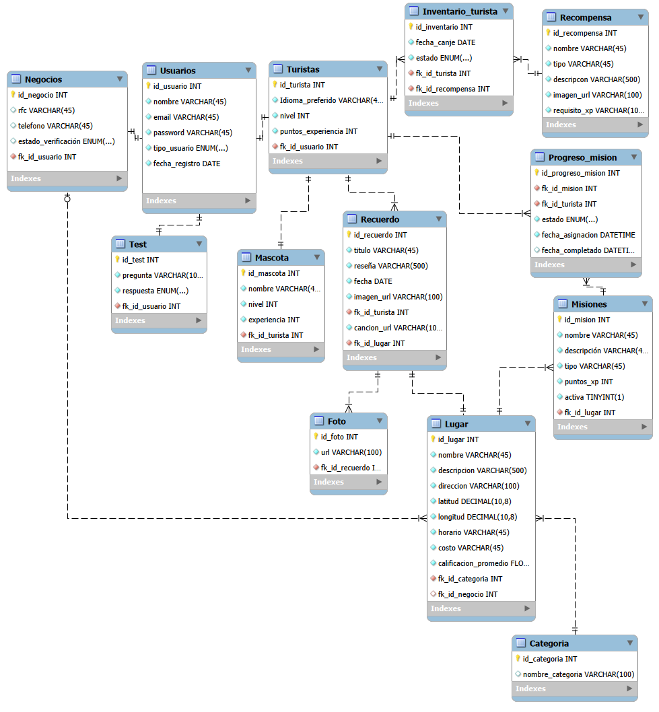

CONECTACO

conecTaco es una plataforma digital que conecta a turistas con lugares, actividades y negocios de la Ciudad de México mediante una experiencia personalizada y gamificada. El sistema contará con dos tipos de usuarios: turistas, quienes podrán seleccionar sus intereses, recibir recomendaciones, explorar lugares mediante un mapa interactivo, participar en actividades y obtener recompensas que les permitan adquirir experiencia y personalizar una mascota virtual; y negocios, quienes podrán registrar y promocionar sus establecimientos, crear actividades, promociones y recompensas para atraer visitantes. De esta manera, conecTaco busca incentivar la exploración de CDMX y, al mismo tiempo, brindar a los negocios una herramienta de promoción e interacción con potenciales clientes. 

BASE DE DATOS

---

ENDPOINTS DE USUARIOS

Al crear un usuario se guarda en `Usuarios` y, según su `tipoUsuario`, también en `Turistas` o en `Negocios`.

| Método | Ruta | Qué hace |
|---|---|---|
| POST | `/v1/usuarios` | Crear usuario (nombre, email, password, tipoUsuario) |
| GET | `/v1/usuarios` | Todos los usuarios |
| GET | `/v1/usuarios/1` | Un usuario por su id |
| GET | `/v1/usuarios?nombre=Olivares&tipoUsuario=Turista&email=...` | Buscar (cada filtro es opcional) |
| PUT | `/v1/usuarios/1` | Reemplazar nombre, email y password (los tres obligatorios) |
| PATCH | `/v1/usuarios/1` | Cambiar solo los datos que se manden |
| DELETE | `/v1/usuarios/1` | Borrar el usuario y su registro de Turistas o Negocios |
| GET | `/v1/turistas` | Todos los turistas |
| GET | `/v1/negocios` | Todos los negocios |

La contraseña debe tener al menos 8 caracteres, una mayúscula, una minúscula, un número y un símbolo, sin espacios. Los errores regresan `{"error": "mensaje"}` con código 400, 404 o 409.

